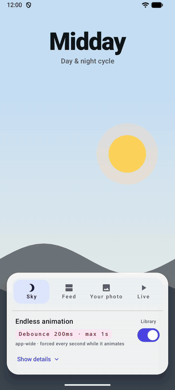

# SmartStatusBar

[](https://github.com/kyrylost/SmartStatusBar/actions/workflows/ci.yml)
[](https://central.sonatype.com/artifact/io.github.kyrylost/smartstatusbar)
[](LICENSE)

`SmartStatusBar` is a library for Jetpack Compose, Compose Multiplatform, and Android Views that looks at what is actually drawn under the status bar on Android and switches the system icons between light and dark for contrast. One call in your Activity covers the whole app.

<p align="center">
  
</p>

## Why

Since Android 15, apps targeting SDK 35 are drawn edge-to-edge: content goes under a transparent status bar, and the app decides whether the icons on top of it are light or dark. `isAppearanceLightStatusBars` is a single flag per window, so the usual approach is to set it per screen from the theme.

That breaks down as soon as the content under the status bar is not known in advance:

- a full-bleed photo, avatar or user-generated image header;
- a list that scrolls a light card under a dark toolbar area, or the other way around;
- maps, video and camera previews;
- a collapsing toolbar that changes color as it collapses.

Hard-coding the flag there leaves white icons on a white photo, and tracking every such case by hand means wiring scroll state, image colors and map styles into status bar logic. `SmartStatusBar` picks the icon color from the pixels, so screens do not need to know about it.

## Quick start

### Installation

The library is on Maven Central. Add it to your module's `build.gradle.kts`:

```kotlin
dependencies {
    implementation("io.github.kyrylost:smartstatusbar:0.1.0")
}
```

In a Compose Multiplatform project, add it to the common source set instead (see [Compose Multiplatform](#compose-multiplatform)):

```kotlin
kotlin {
    sourceSets {
        commonMain.dependencies {
            implementation("io.github.kyrylost:smartstatusbar:0.1.0")
        }
    }
}
```

### Usage

Place `SmartStatusBarEffect` once, above your content:

```kotlin
class MainActivity : ComponentActivity() {
    override fun onCreate(savedInstanceState: Bundle?) {
        enableEdgeToEdge()
        super.onCreate(savedInstanceState)
        setContent {
            MaterialTheme {
                SmartStatusBarEffect()

                AppNavigation()
            }
        }
    }
}
```

That is all most apps need. The default strategy re-evaluates the icons after every scroll, navigation or other change on screen, as soon as it settles. Screens contain no status bar code.

*(For View-based apps using XML layouts or Fragments, see [Views (XML layouts, Fragments)](#views-xml-layouts-fragments).)*

If only one screen needs it, place the effect on that screen instead. While the screen is shown the effect controls the icons; when it leaves, the icon appearance from before it is restored.

The sample app (`:sample`, or its APK on the [releases page](https://github.com/kyrylost/SmartStatusBar/releases)) shows this on an endless day and night animation, a photo feed, a photo of your own from the gallery and a `SurfaceView`, with a switch to compare against the library being off. The title of every screen takes its color from `currentStatusBarBackground()`.

## Choosing a strategy

| Content under the status bar | Strategy |
| --- | --- |
| Compose content: scrolling lists, photos, collapsing headers, transitions, animations | `Debounce` (the default) |
| `SurfaceView` (video, camera, maps), anything drawn without redrawing the window | `Periodic` |
| Content you change yourself, where you know the exact moment | `Manual` + `requestUpdate()` |

- **`UpdateStrategy.Debounce(timeout = 200 ms, maxWait = 1 s)`**: checks once draw events have been quiet for `timeout`, so icons never change while the user is still scrolling or watching a transition. The first check after a screen appears waits the same way. Content that redraws continuously (shimmer, progress indicator, a running animation) never goes quiet, so a check is forced at least once per `maxWait`; use a shorter `maxWait` for icons that should follow an animation more closely, or `Duration.INFINITE` to disable it.
- **`UpdateStrategy.Periodic(interval = 250 ms)`**: checks on a timer regardless of redraws. A `SurfaceView` renders on its own thread and the window never redraws, so Debounce would not notice a change. (A `TextureView` does redraw the window, so Debounce with a short `maxWait` is enough.)
- **`UpdateStrategy.Manual`**: checks only when you call `requestUpdate()` on a controller (and once when it resumes after an override):

```kotlin
val controller = rememberSmartStatusBarController()

AsyncImage(model = url, contentDescription = null, onSuccess = { controller.requestUpdate() })
```

It is safe to call right after changing what is on screen: the check waits until the new content has been rendered. A controller addresses the window, not a particular effect, so it can be created anywhere on the screen, and `requestUpdate()` also speeds up the other strategies. With Debounce, though, you rarely need it: an image that finishes loading redraws the window, and the check follows. (A `Dialog` or a bottom sheet has its own window, so a controller created inside one does not reach the Activity's effect.)

### Per-screen override

A screen that needs a different strategy declares an override. While that screen is shown the override takes over and the app-wide effect pauses; when the screen leaves, the app-wide effect resumes:

```kotlin
@Composable
fun PlayerScreen() {
    // Video is drawn in a SurfaceView, which does not redraw the window: poll instead.
    SmartStatusBarOverride(config = SmartStatusBarConfig(strategy = UpdateStrategy.Periodic()))

    VideoPlayer()
}
```

An override always wins over `SmartStatusBarEffect`, wherever either is declared, so switching the app-wide effect off and on (a feature flag, a setting) does not take over from the screen. Among several overrides the one attached last is active, and the one before it resumes when it leaves: an override nested in another screen's override hands control back to it. Whatever resumes checks the screen right away, whatever its strategy. When the last effect or override leaves, the icon appearance from before the first one is restored.

### Configuration

```kotlin
SmartStatusBarEffect(
    config = SmartStatusBarConfig(
        strategy = UpdateStrategy.Debounce(timeout = 200.milliseconds, maxWait = 500.milliseconds),
        sideFraction = 0.2f,
        lightThreshold = 0.5f,
        hysteresis = 0.05f,
    ),
)
```

`sideFraction` is the share of the width analyzed at each end of the bar, `lightThreshold` the luma above which a pixel counts as light (0.5 is about 128/255), and `hysteresis` the dead zone around 50% light pixels in which the icons keep their color. The defaults suit most screens.

## Matching your own content

`currentStatusBarBackground()` returns what the active effect last found under the status bar, so content of your own drawn there can match the system icons, for example a transparent toolbar over a photo:

```kotlin
val iconTint = when (currentStatusBarBackground()) {
    StatusBarBackground.Light -> Color.Black
    StatusBarBackground.Dark -> Color.White
    null -> LocalContentColor.current // no check yet, or not on Android
}
IconButton(onClick = onBack) {
    Icon(Icons.AutoMirrored.Filled.ArrowBack, contentDescription = "Back", tint = iconTint)
}
```

It follows the same decision as the system icons, hysteresis included, and recomposes when it changes. It describes the status bar area only, so it suits content right below it, not further down the screen.

## Views (XML layouts, Fragments)

Apps without Compose use `SmartStatusBar` instead of the composables. It follows the same rules and shares the window with them, so a View-based Activity can host Compose screens and the other way around:

```kotlin
class MainActivity : AppCompatActivity() {
    override fun onCreate(savedInstanceState: Bundle?) {
        enableEdgeToEdge()
        super.onCreate(savedInstanceState)
        setContentView(R.layout.activity_main)
        SmartStatusBar.install(this) // like SmartStatusBarEffect()
    }
}

class PlayerFragment : Fragment(R.layout.fragment_player) {
    override fun onViewCreated(view: View, savedInstanceState: Bundle?) {
        // Like SmartStatusBarOverride: active while the fragment's view exists.
        SmartStatusBar.override(
            requireActivity().window,
            viewLifecycleOwner,
            SmartStatusBarConfig(strategy = UpdateStrategy.Periodic()),
        )
    }
}
```

Each call detaches when its lifecycle is destroyed and returns a `SmartStatusBarHandle` with `requestUpdate()`, `remove()` and `background`, a `StateFlow` of what `currentStatusBarBackground()` returns in Compose. `SmartStatusBar.install(window, lifecycleOwner)` puts the library on a single fragment.

To match your own View content (such as a toolbar icon color) with the status bar background:

```kotlin
lifecycleScope.launch {
    repeatOnLifecycle(Lifecycle.State.STARTED) {
        handle.background.collect { bg ->
            val tint = if (bg == StatusBarBackground.Light) Color.BLACK else Color.WHITE
            binding.toolbar.navigationIcon?.setTint(tint)
        }
    }
}
```

## Compose Multiplatform

The whole API is available in common code, so a shared `App()` can call `SmartStatusBarEffect()` directly. Only Android needs it; on the other targets every call does nothing:

- **iOS**: from iOS 17, the default status bar style (`UIStatusBarStyle.default`) picks light or dark content from what is underneath on its own. Before iOS 17 it follows the system dark mode, and an app that sets `preferredStatusBarStyle` itself gets no adaptation.
- **Desktop and web** have no status bar.

Targets: Android, iOS (`iosArm64`, `iosSimulatorArm64`, `iosX64`), macOS (`macosArm64`, `macosX64`), desktop JVM, `js` and `wasmJs`, the same as Compose Multiplatform 1.7.

## Debug overlay

`SmartStatusBarDebugOverlay()` shows what the library sees: the captured strip enlarged with the zones that are not analyzed dimmed, the share of light pixels, the decision, and how long the capture took. Use it to tune the configuration or to find out why a screen gets the wrong icons. Do not place it under the status bar: what it draws there would be analyzed too.

*(For View-based apps, embed `SmartStatusBarDebugOverlay()` inside a `ComposeView`.)*

## How it works

```
 window content ──PixelCopy──▶ 64×4 strip ──▶ left/right zones ──▶ light pixel share ──▶ hysteresis ──▶ isAppearanceLightStatusBars
 (status bar area)             (downscaled)    (sideFraction)       (lightThreshold)       (hysteresis)
```

1. **Capture.** `PixelCopy` copies the status bar area of the app window (minus a margin of 4 dp on each side) into a 64×4 bitmap. The copy contains only the app's own surface, never the system icons drawn on top of it, so the result does not depend on the current icon color.

   `SurfaceView` content lives in a separate surface and shows through a transparent hole in the window. When the capture has transparent pixels, the `SurfaceView`s under the status bar are copied separately and the window is composited on top of them, so a toolbar drawn over a video still counts. Several overlapping surfaces are stacked in drawing order; `setZOrderOnTop` is not taken into account.
2. **Zones.** Only the left and right `sideFraction` of the strip are analyzed: that is where the clock, battery and notification icons are. A bright banner in the middle does not affect the decision.
3. **Brightness.** Each pixel's luma (Rec. 601 on gamma-encoded sRGB, without linearization: cheap and accurate enough for a binary decision) is compared with `lightThreshold`, giving the share of light pixels. Fully transparent pixels are ignored.
4. **Hysteresis.** Icons switch only when the share crosses `0.5 ± hysteresis`.
5. **Apply.** The result is written to `WindowInsetsControllerCompat.isAppearanceLightStatusBars`, only when it actually changes.

Checks run only while the lifecycle owner of the composition (the Activity, or a navigation back stack entry) is at least `STARTED`.

## Performance

A check copies a 64×4 strip, which is small, but `PixelCopy.request` is called on the main thread. On an API 36 arm64 emulator the call blocked the main thread for 0.1–5 ms, and the pixels were ready 1–6 ms after the request. Debounce checks only when the screen has gone quiet (or once per `maxWait`), so they do not run during a scroll; Periodic runs every `interval` for as long as the screen is shown.

These numbers come from an emulator with software rendering. Real devices differ, so measure yours: `SmartStatusBarDebugOverlay` prints both timings.

## When you do not need it

- You know the color. If a screen draws a fixed scrim or a toolbar whose color you control, setting `isAppearanceLightStatusBars` from the theme is cheaper and exact.
- The color comes from data you already have, for example a `Palette` of the image or the collapse fraction of a toolbar. Computing the flag from that avoids capturing pixels at all.
- A gradient scrim behind the status bar makes the icons readable on any image, with no code.

## Limitations

- **Edge-to-edge**: the host Activity must call `enableEdgeToEdge()` itself; the library only controls `isAppearanceLightStatusBars`. Calling `enableEdgeToEdge()` again resets the icons until the next check.
- **Setting the icons yourself**: while an effect is active it owns `isAppearanceLightStatusBars`, and its next check replaces whatever you set. When a screen with an effect leaves, it restores the appearance from before it at the end of the exit transition, after the next screen has been composed. A value the next screen set on its first composition is then overwritten, so set it after the transition (or let an effect handle that screen too).
- **Kotlin**: built with Kotlin 2.4, so projects need Kotlin 2.3 or newer.
- **Minimum SDK**: the library supports `minSdk = 23`, but capturing the window with `PixelCopy` needs API 26 (Android 8.0). On API 23–25 `SmartStatusBarEffect` does nothing and leaves the icons as the app set them.
- **Protected content (DRM video)**: content that `PixelCopy` refuses to read cannot be analyzed; the previous icon appearance is kept. After 3 consecutive failed captures, automatic checks are throttled to one per 2 seconds. Whether a given kind of protected content can be read depends on the device and Android version: on an API 36 emulator `PixelCopy` read both a `FLAG_SECURE` window and a secure `SurfaceView`, so do not rely on either for hiding content.
- **Dialogs and popups**: `Dialog`, `Popup` and bottom sheets render in separate windows and are not part of the main window capture.
- **Pagers**: a `HorizontalPager` composes the neighboring pages too, so a per-page effect or override would be attached before its page is visible. Use one effect above the pager.
- **Navigation bar**: only the status bar is handled.

## License

```
Copyright 2026 Kyrylo Stukalo

Licensed under the Apache License, Version 2.0 (the "License");
you may not use this file except in compliance with the License.
You may obtain a copy of the License at

    http://www.apache.org/licenses/LICENSE-2.0

Unless required by applicable law or agreed to in writing, software
distributed under the License is distributed on an "AS IS" BASIS,
WITHOUT WARRANTIES OR CONDITIONS OF ANY KIND, either express or implied.
See the License for the specific language governing permissions and limitations under the License.
```
